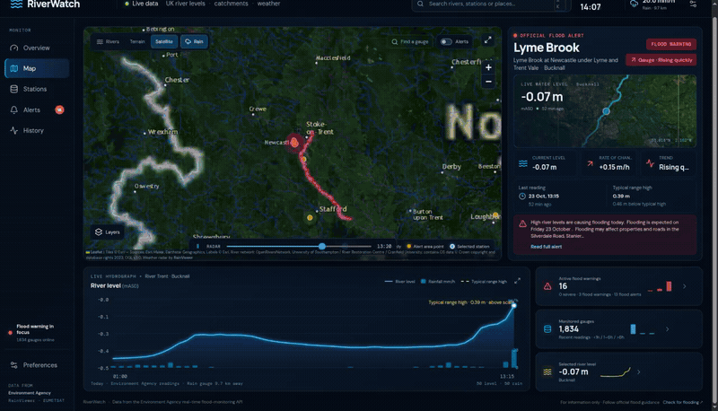

# RiverWatch

RiverWatch is a visual river monitoring dashboard for England and Scotland. It brings together Environment Agency and SEPA gauge readings, Environment Agency flood alerts, weather radar and Meteosat satellite imagery.

Scottish gauges are searchable by station name or “Scotland” and include today's level history from [SEPA's Time Series Data Service](https://timeseriesdoc.sepa.org.uk/). Scottish data © SEPA, licensed under the Open Government Licence 3.0. SEPA refreshes every five minutes; each reading retains its original observation time, which may be older. If SEPA is unavailable, the last fetched Scottish readings remain visible with a delayed-feed label. Scottish rainfall and typical-range thresholds are not connected.

Scottish flood alerts are not connected: SEPA's Floodline API requires requesting access. Use [SEPA's official flood warnings](https://beta.sepa.scot/flooding/). The app labels this gap when viewing Scottish gauges and on the Alerts page.

Enable **Layers → Weather warnings** to show Met Office warning polygons with yellow, amber and red outlines and shading. Click an area for current/upcoming validity, affected regions and details. Configure `MET_OFFICE_API_KEY` in the server's `.env` (automatically loaded, ignored by Git) to use the NSWWS v1.1 API. Warning data refreshes independently every minute. The key stays on the server. Without a key, the public RSS fallback uses explicitly labelled regional points. Failed authenticated requests report unavailable coverage rather than substituting approximate boundaries. Weather warnings © Crown copyright, Met Office. Requires Node.js 22 or later.

The separate `MET_OFFICE_MAP_API_KEY` is reserved for Met Office forecast map images. This service requires a configured Weather DataHub map-image order; a key alone does not provide images. It supplies model forecasts rather than observed rainfall radar. RiverWatch currently uses RainViewer for radar; forecast map images are not yet displayed.

The **Latest briefing** panel runs automatically without a chat box. Set `OPENROUTER_API_KEY` in `.env`; the default model is `google/gemma-4-26b-a4b-it:free`. `OPENROUTER_MODEL` can select another explicitly `:free` model or `openrouter/free`; paid models are rejected and prompt, completion and request price limits are zero. Only compact public river/weather facts go to OpenRouter. The model chooses up to three known fact IDs; the app validates those IDs and displays its own verified wording and source links. AI does not predict flooding or write safety advice. The panel labels AI selections separately from the rule-based live-facts fallback.

One server-wide AI attempt is allowed per 30 minutes, with a hard cap of 24 attempts per UTC day, including failures. Attempts and successful selections persist in the ignored `.cache/briefing.json` so restarting does not reset the allowance. No additional requests are triggered by visitors, page reloads or gauge selection. Calls require a meaningful change in warning identity/status/version, rising-level signals or coarse freshness counts. Changed facts invalidate the AI selection immediately; fresh deterministic highlights remain available during cooldowns or provider failures. AI selections expire after an hour and briefings stop displaying facts if the river snapshot is more than 15 minutes old. Official warning layers update independently. This local allowance is designed for a single Node server instance; multiple replicas would need shared allowance storage. Free-provider availability and account limits may cause the app to use live facts. `npm test` includes offline tests for these safeguards.

Caching is in memory and bounded: concurrent upstream and browser requests share a fetch, live upstream responses and gauge details expire after one minute, station metadata after one hour, river geometry after six hours and flood-area geometry after one hour. The selected gauge history refreshes every minute; the full gauge network still refreshes every five minutes. Weather warnings refresh independently every minute. Failed requests are not cached. Cache reuse preserves original observation times; it never makes an old reading appear newly observed. Client and server live caches can together add up to approximately two minutes of delay to selected gauge history. Run regression checks with `node --test server/*.test.mjs shared/*.test.mjs`.



## Run it

Requirements: Node.js 22.12+ and npm.

```bash
cd riverwatch
npm install
npm run dev
```

Open the local URL printed by Vite, normally `http://localhost:5173`.

For a production build:

```bash
npm run build
npm start
```

`npm start` serves the built dashboard and its WebSocket feed at `http://localhost:3001`.

## Hosting

The frontend and Node service run together, including `/api` and the `/ws` live connection. Static-only hosts cannot run the complete application. The production image builds and tests the source, then runs as an unprivileged user with production dependencies. Runtime credentials are supplied through the ignored `.env` file; `.cache` preserves the AI allowance across restarts. Hashed frontend assets can be cached for a year while HTML revalidates and API responses remain uncached by browsers.

Pushes to `main` trigger the deployment workflow, which builds an immutable image tagged with the commit SHA, archives it in GHCR, starts the release and checks health. To restore a previous release, dispatch **Deploy RiverWatch** with its SHA in `rollback_tag`. Deployment state and credentials are preserved separately from releases.

## Demo

The short screen recording shows the central England alert view with live radar playback: [Watch the RiverWatch demo (MP4)](docs/screenshots/riverwatch-demo.mp4). The original visual reference is in [`docs/design-reference.png`](docs/design-reference.png).

## Dashboard

- **UK map:** opens on a UK-wide view with the highest-severity active flood warning selected. Official warning-area points and selected gauge remain visible; the dense station layer is off by default and can be enabled in Layers. Select any warning to zoom into its area. A selected-river flow line and subdued Great Britain river network use published geometry. Search by station, river, catchment or town. Choose a dark map, terrain or satellite basemap.
- **Weather layers:** rainfall radar reflectivity starts on when the feed is available, and recent frames can be animated. The separate Meteosat cloud layer shows near-real-time satellite imagery.
- **Gauge details:** latest measured level, recent rate of change, reading time and published typical-range high where the station supplies one.
- **Hydrograph:** today's actual readings for the selected gauge, with bars for the nearest Environment Agency rainfall gauge when one is available within 30 km. The rainfall series is converted from its published accumulation interval to mm/h and identifies the gauge distance. The plotted river range follows the gauge readings; a typical-range reference outside that range is called out separately. Typical range is not a flood threshold.
- **Official alerts:** current Environment Agency flood alerts and warnings, sorted by severity. The highest-severity active alert is focused on startup. Select any alert card or map point to fly to its published area coordinate and nearest reporting gauge.
- **Stations and history:** search by station, river or place with keyboard navigation, browse gauge readings or inspect the selected gauge's hydrograph. Save favourite gauges and share links that open a particular station.
- **Preferences:** basemap, overlay switches, opacity, selected station and favourites persist in this browser. Reset display settings keeps favourites and the selected station. Storage failures are shown without blocking the dashboard.
- **Feed status:** unavailable warnings are distinguished from an empty feed; delayed or missing observations and unpublished typical ranges have explicit labels. Readings older than one hour are marked delayed.
- **Weather warnings:** browse all, in-force or upcoming Met Office warnings and zoom to their published polygon areas.

The map is designed as the first module of a broader public-data alert hub. Additional dashboards can use the same visual language while keeping each feed's source, update rate, measurements and alert rules distinct.

## Data and attribution

- River levels and flood warnings: [Environment Agency real-time flood-monitoring API](https://environment.data.gov.uk/flood-monitoring/doc/reference). The API is open data under the Open Government Licence. Readings are often around 15 minutes apart, while data transfer frequency varies by station. RiverWatch refreshes its list every five minutes and shows each gauge's own reported time.
- River linework: [OpenRiversNetwork](https://www.openrivers.net/), served as a Great Britain WMS river network and queried for the selected named river. The dataset is published under OGL v3 and includes Ordnance Survey attribution requirements, which are displayed on the map.
- Rainfall gauge observations: [Environment Agency real-time flood-monitoring API](https://environment.data.gov.uk/flood-monitoring/doc/reference); the nearest gauge within 30 km is used and labelled. Radar: [RainViewer Weather Maps API](https://www.rainviewer.com/api/weather-maps-api.html). Radar frames are shown as reflectivity imagery. The free API is intended for personal, educational and small community use, requires visible attribution, and has no service guarantee. Confirm its current terms before wider or commercial deployment.
- Satellite: [EUMETSAT EUMETView Web Map Service](https://view.eumetsat.int/), using the Meteosat Geo Colour RGB layer. The map also offers Esri satellite imagery as a basemap.
- Map tiles: Esri imagery/dark basemap and OpenTopoMap terrain. Provider credits are displayed on the map.

The browser keeps a WebSocket open to the Node service. It refreshes the full gauge network every five minutes and pushes snapshots over the socket. Selected gauge history, weather warnings and the RainViewer manifest refresh independently every minute. Radar starts without waiting for a river snapshot. Only the displayed tile grid is loaded while paused; playback buffers one next frame and waits for tiles before advancing, retaining the previous image during loading. Radar tile timestamps stay visible and tile failures are labelled. River geometry is fetched on selection and cached. Briefing clients read the shared result without triggering AI calls.

RiverWatch is an informational viewer, not a flood warning service or a safety-critical system. Map alert dots mark Environment Agency flood-area coordinates; they are area reference points, not the boundary of flooded land. A gauge being below its typical-range high does not mean there is no local flood risk. Warning areas may not map one-to-one to a river gauge. Always follow the [official UK flood guidance](https://www.gov.uk/check-flooding) and local emergency advice.

The first release uses transparent measurements and trend calculations. It does not yet train or run a machine-learning classifier; anomaly detection will need a validated station-specific model and historical examples before it can be presented as an alert.

## Project structure

```text
src/
  main.jsx       React entry point
  ui.jsx         Dashboard, WebSocket client, map and charts
  style.css      Responsive dark visual system
server/
  server.mjs     Feed cache, WebSocket snapshots and selected-station data
public/          Static assets
docs/screenshots/ Desktop capture, demo video and animated preview
```

## License

Source code: MIT. Third-party map, radar, satellite and river data remain subject to their providers' attribution and usage terms.
