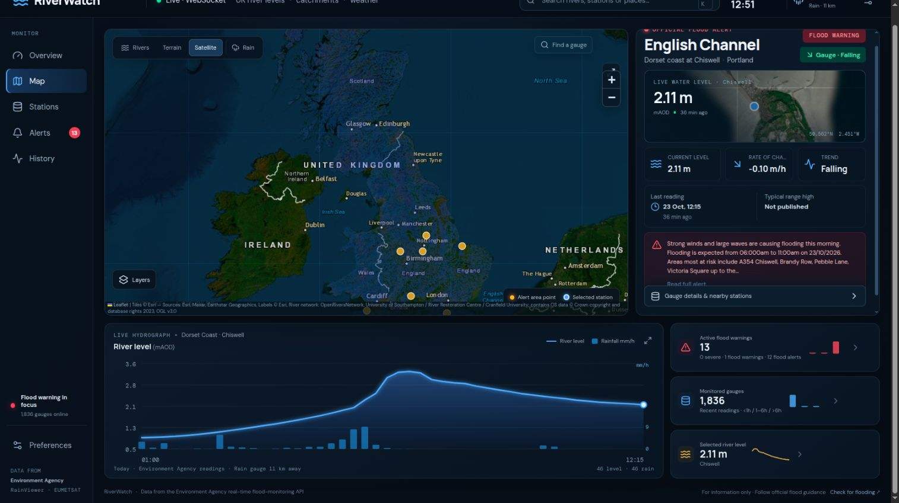
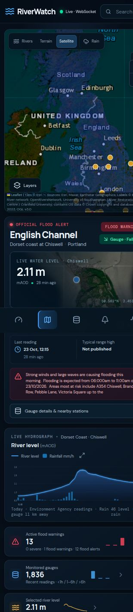

# RiverWatch

RiverWatch is a visual UK river monitoring dashboard. Its first dashboard brings together live Environment Agency gauge readings and flood alerts with weather radar and Meteosat satellite imagery.



## Run it

Requirements: Node.js 20.19+ or 22.12+ and npm.

```bash
cd riverwatch
npm install
npm run dev
```

Open the local URL printed by Vite, normally `http://localhost:5173`.

For a production build:

```bash
npm run build
npm start
```

`npm start` serves the built dashboard and its WebSocket feed at `http://localhost:3001`.

## Hosting

The complete live application cannot run on GitHub Pages alone. Pages serves static files, while RiverWatch also needs the Node service in `server/server.mjs` to fetch and cache public data, provide gauge and river geometry endpoints, and stream dashboard updates. For a public deployment, host the frontend on Pages and the Node service on a separate host that supports persistent WebSocket connections, then configure the frontend to connect to that service. That remote-service configuration is not included yet; the supported setup today is running the app with `npm run dev` or `npm start` on a machine that can run Node.js.

The screenshots below show the dashboard on desktop and mobile. The original visual reference is in [`docs/design-reference.png`](docs/design-reference.png).



## Dashboard

- **UK map:** opens on a UK-wide view with the highest-severity active flood warning selected. Official warning-area points and selected gauge remain visible; the dense station layer is off by default and can be enabled in Layers. Select any warning to zoom into its area. A selected-river flow line and subdued Great Britain river network use published geometry. Search by station, river, catchment or town. Choose a dark map, terrain or satellite basemap.
- **Weather layers:** toggle rainfall radar and animate recent frames. The separate Meteosat cloud layer shows near-real-time satellite imagery.
- **Gauge details:** latest measured level, recent rate of change, reading time and published typical-range high where the station supplies one.
- **Hydrograph:** today's actual readings for the selected gauge, with bars for the nearest Environment Agency rainfall gauge when one is available within 30 km. The rainfall series is converted from its published accumulation interval to mm/h and identifies the gauge distance. The plotted river range follows the gauge readings; a typical-range reference outside that range is called out separately. Typical range is not a flood threshold.
- **Official alerts:** current Environment Agency flood alerts and warnings, sorted by severity. The highest-severity active alert is focused on startup. Select any alert card or map point to fly to its published area coordinate and nearest reporting gauge.
- **Stations and history:** browse gauge readings or inspect the selected gauge's hydrograph.

The map is designed as the first module of a broader public-data alert hub. Additional dashboards can use the same visual language while keeping each feed's source, update rate, measurements and alert rules distinct.

## Data and attribution

- River levels and flood warnings: [Environment Agency real-time flood-monitoring API](https://environment.data.gov.uk/flood-monitoring/doc/reference). The API is open data under the Open Government Licence. Readings are often around 15 minutes apart, while data transfer frequency varies by station. RiverWatch refreshes its list every five minutes and shows each gauge's own reported time.
- River linework: [OpenRiversNetwork](https://www.openrivers.net/), served as a Great Britain WMS river network and queried for the selected named river. The dataset is published under OGL v3 and includes Ordnance Survey attribution requirements, which are displayed on the map.
- Rainfall gauge observations: [Environment Agency real-time flood-monitoring API](https://environment.data.gov.uk/flood-monitoring/doc/reference); the nearest gauge within 30 km is used and labelled. Radar: [RainViewer Weather Maps API](https://www.rainviewer.com/api/weather-maps-api.html). Radar frames are shown as reflectivity imagery. The free API is intended for personal, educational and small community use, requires visible attribution, and has no service guarantee. Confirm its current terms before wider or commercial deployment.
- Satellite: [EUMETSAT EUMETView Web Map Service](https://view.eumetsat.int/), using the Meteosat Geo Colour RGB layer. The map also offers Esri satellite imagery as a basemap.
- Map tiles: Esri imagery/dark basemap and OpenTopoMap terrain. Provider credits are displayed on the map.

The browser keeps a WebSocket open to the local Node service. That service refreshes the upstream HTTP feeds every five minutes and pushes snapshots over the socket; the browser does not poll for dashboard data or reload the page. River history and selected-river geometry are requested once when selection changes. Public upstream services do not provide a WebSocket feed, so the server-side fetch cadence follows their published update rates.

RiverWatch is an informational viewer, not a flood warning service or a safety-critical system. Map alert dots mark Environment Agency flood-area coordinates; they are area reference points, not the boundary of flooded land. A gauge being below its typical-range high does not mean there is no local flood risk. Warning areas may not map one-to-one to a river gauge. Always follow the [official UK flood guidance](https://www.gov.uk/check-flooding) and local emergency advice.

The first release uses transparent measurements and trend calculations. It does not yet train or run a machine-learning classifier; anomaly detection will need a validated station-specific model and historical examples before it can be presented as an alert.

## Project structure

```text
src/
  main.jsx       React entry point
  ui.jsx         Dashboard, WebSocket client, map and charts
  style.css      Responsive dark visual system
server/
  server.mjs     Feed cache, WebSocket snapshots and selected-station data
public/          Static assets
docs/screenshots/ Dashboard capture
```

## License

Source code: MIT. Third-party map, radar, satellite and river data remain subject to their providers' attribution and usage terms.
